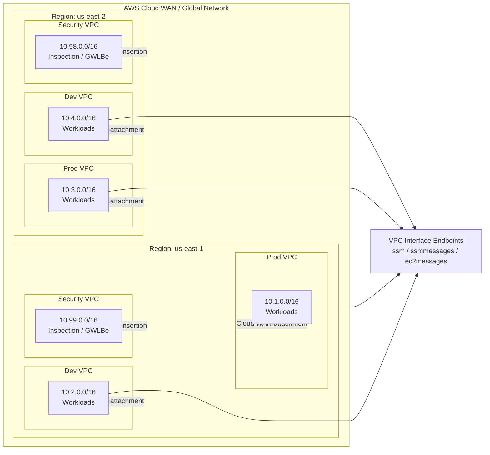
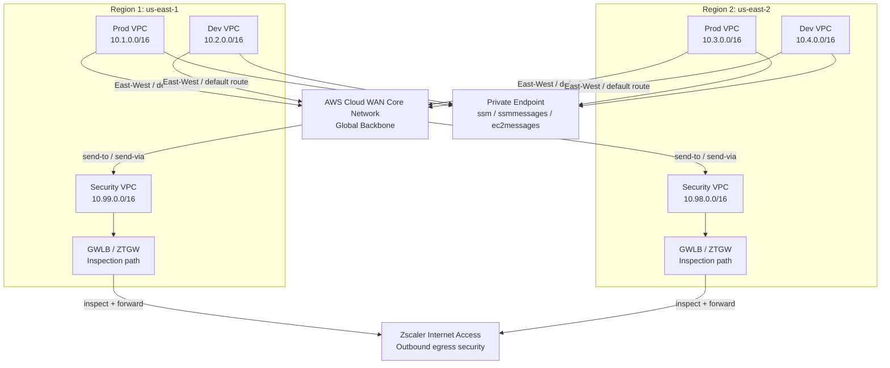
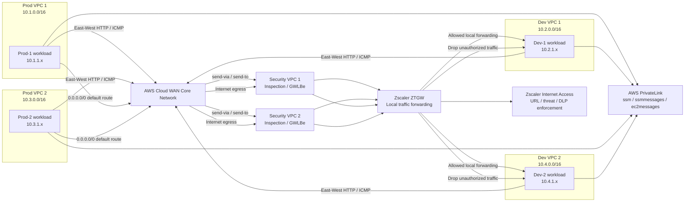

# AWS Cloud WAN ZTGW Terraform

This repository contains a Terraform deployment that follows the AWS Cloud WAN multi-region architecture described in the Cloud WAN deployment guide for a two-region design spanning `us-east-1` and `us-east-2`.

The project is intentionally parameterized so the key deployment values are driven by variables:

- AWS region
- naming prefix (for example `dglading-cloud-wan-`)
- VPC endpoint service name (for example `com.amazonaws`)

## What this Terraform creates

For the selected region, it provisions:

- 3 VPCs:
  - Production
  - Development
  - Security
- Subnets per the guide’s layout:
  - Cloud WAN attachment subnets
  - workload subnets
  - inspection subnets for the security VPC
- Workload security groups
- VPC interface endpoints for:
  - `ssm`
  - `ssmmessages`
  - `ec2messages`

This provides the network foundation and VPC endpoint layer used by the AWS Cloud WAN + ZTGW design.

## Files

- `versions.tf` — Terraform and provider version requirements
- `provider.tf` — AWS provider configuration
- `variables.tf` — input variables
- `locals.tf` — derived values and subnet/VPC naming logic
- `main.tf` — AWS resources
- `outputs.tf` — resource outputs
- `terraform.tfvars.example` — example variable values
- `.gitignore` — standard Terraform exclusions

## Variables

The main variables are:

```hcl
aws_region = "us-east-1"
naming_prefix = "dglading-cloud-wan-"
vpc_endpoint_service_name = "com.amazonaws"
region_suffix = "1"
```

## Quickstart

### 1) Create your variable file

```bash
cp terraform.tfvars.example terraform.tfvars
```

Example contents for `us-east-1`:

```hcl
aws_region = "us-east-1"
naming_prefix = "dglading-cloud-wan-"
vpc_endpoint_service_name = "com.amazonaws"
region_suffix = "1"
```

Example contents for `us-east-2`:

```hcl
aws_region = "us-east-2"
naming_prefix = "dglading-cloud-wan-"
vpc_endpoint_service_name = "com.amazonaws"
region_suffix = "2"
```

### 2) Initialize Terraform

```bash
terraform init
```

### 3) Validate the configuration

```bash
terraform validate
```

### 4) Review the deployment plan

```bash
terraform plan
```

### 5) Apply the deployment

```bash
terraform apply
```

### 6) Destroy the deployment when finished

```bash
terraform destroy
```

## Prerequisites

Before deploying this configuration, make sure you have:

- AWS CLI installed and configured with valid credentials
- An AWS account with permissions to create VPCs, subnets, security groups, and VPC interface endpoints
- Access to the target AWS regions used by the deployment (`us-east-1` and/or `us-east-2`)
- Terraform 1.5 or newer installed locally

Example AWS authentication:

```bash
aws configure
# or
export AWS_PROFILE=my-profile
export AWS_REGION=us-east-1
```

Required IAM permissions typically include actions such as:

- `ec2:CreateVpc`
- `ec2:CreateSubnet`
- `ec2:CreateSecurityGroup`
- `ec2:AuthorizeSecurityGroupIngress`
- `ec2:AuthorizeSecurityGroupEgress`
- `ec2:CreateVpcEndpoint`
- `ec2:Describe*`
- `ec2:ModifyVpcAttribute`

If you are using AWS Organizations or a restricted role, confirm that your deployment identity has the required EC2 and VPC permissions.

## Notes

- The configuration is designed to match the naming conventions and CIDR layout in the deployment guide.
- The Cloud WAN Global Network and Core Network resources themselves are typically created in the AWS console and may require additional AWS Network Manager setup beyond the resource types in this file set.
- This project focuses on the reusable AWS VPC, subnet, security group, and interface endpoint foundation for the architecture.

## Deployment diagram



This represents the deployment pattern described in the guide: a multi-region Cloud WAN backbone with production and development spoke VPCs in each region, a centralized security VPC for inspection, and private SSM interface endpoints used for management without public ingress.

## Detailed inspection and egress flow



This diagram shows the intended security path for the guide: workload VPCs attach to Cloud WAN, default and east-west traffic can be steered into the Security VPC, and the Security VPC hosts the inspection path (GWLBe / ZTGW) that then forwards to Zscaler Internet Access for outbound policy enforcement. Private VPC endpoints provide management connectivity without public ingress.

## East-west and outbound egress flow



This diagram reflects the guide’s traffic patterns:

- East-west traffic between the Prod and Dev segments is regulated by local forwarding rules and default drop rules per region.
- Outbound traffic to the public internet is sent to the Security VPC and then inspected by the ZTGW and ZIA policy enforcement stack.
- Management traffic to AWS Systems Manager uses private VPC interface endpoints instead of public ingress.

## Example variable file

See `terraform.tfvars.example` for a ready-to-edit example.
