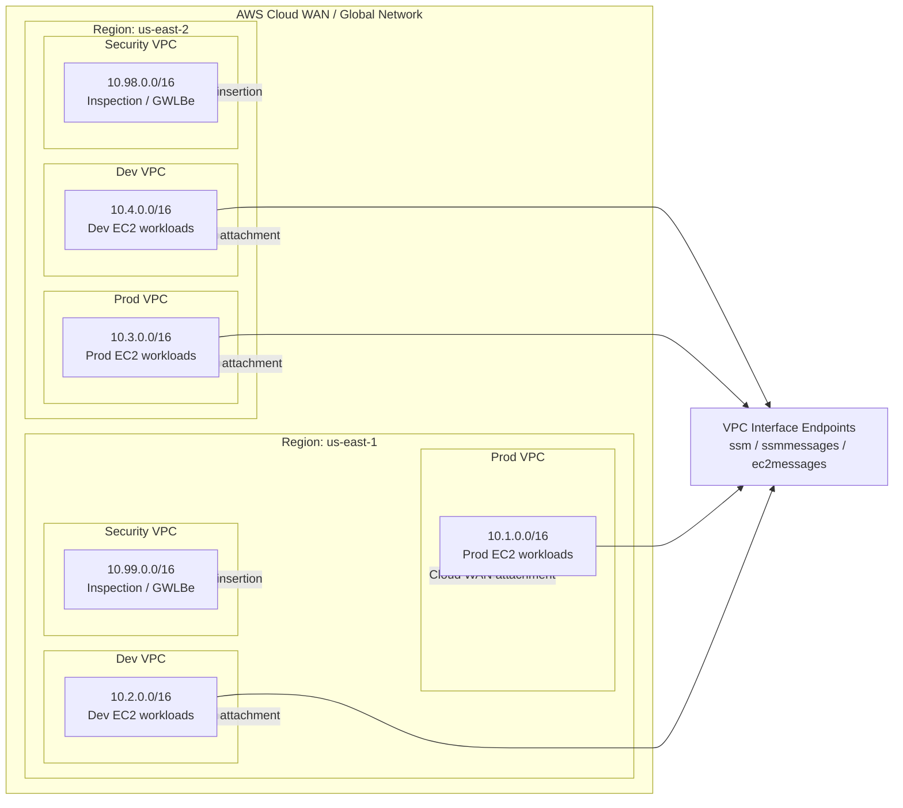
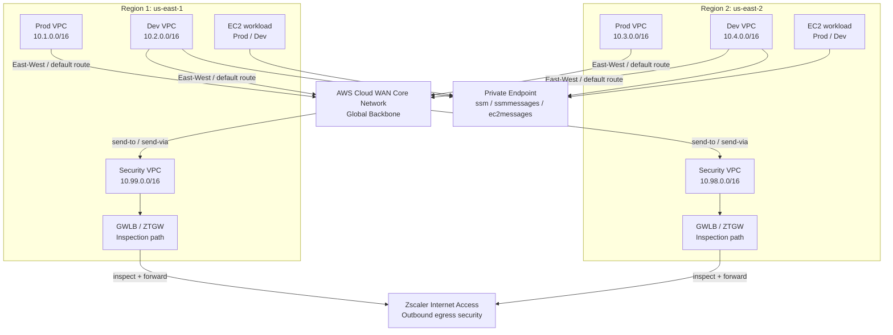

# AWS Cloud WAN ZTGW Terraform

This repository contains a Terraform deployment that follows the AWS Cloud WAN multi-region architecture described in the Cloud WAN deployment guide for a two-region design spanning `us-east-1` and `us-east-2`.

The project is intentionally parameterized so the key deployment values are driven by variables:

- AWS region
- naming prefix (for example `dglading-cloud-wan-`)
- VPC endpoint service name (for example `com.amazonaws`)
- optional multi-region deployment switch (`multiregion_deployment`)

## What this Terraform creates

For the selected region, it provisions:

- 3 VPCs:
  - Production
  - Development
  - Security
- Subnets per the guide’s layout:
  - Cloud WAN attachment subnets
  - workload subnets
  - inspection subnets for the security VPC
- Workload security groups
- EC2 workload instances in the Prod and Dev workload subnets
- VPC interface endpoints for:
  - `ssm`
  - `ssmmessages`
  - `ec2messages`

This provides the network foundation, workload layer, and VPC endpoint layer used by the AWS Cloud WAN + ZTGW design.

## EC2 workload behavior

The EC2 instances are created in the workload subnets for each Prod and Dev VPC, using the same naming prefix convention and region-based suffixing as the surrounding deployment.

The instance names follow the pattern:

```hcl
${var.naming_prefix}${vpc.short_name}-${az}-ec2
```

Examples:

```hcl
"dglading-cloud-wan-prod1-aza-ec2"
"dglading-cloud-wan-dev2-azb-ec2"
```

The deployment does not currently install web services through EC2 user data by default; the current implementation provisions Amazon Linux 2 instances in the workload subnets and exposes them through the workload security groups. If you want the PDF’s HTTP service behavior exactly replicated, you can add a `user_data` bootstrap script to install and start `httpd`, as described below.

### Optional user-data bootstrap for HTTP

To match the PDF more closely, the EC2 instances can be configured to install and start Apache HTTPD using EC2 user data:

```hcl
user_data = <<-EOF
#!/bin/bash
yum update -y
yum install -y httpd
systemctl enable httpd
systemctl start httpd
EOF
```

This is not enabled by default in the Terraform because the original guide’s EC2 app-layer implementation varies by deployment scenario, but it is easy to add to the `aws_instance` resource blocks if you want the instances to serve HTTP traffic immediately after launch.

## Files

- `versions.tf` — Terraform and provider version requirements
- `provider.tf` — AWS provider configuration
- `variables.tf` — input variables
- `locals.tf` — derived values and subnet/VPC naming logic
- `main.tf` — AWS resources
- `outputs.tf` — resource outputs
- `terraform.tfvars.example` — example variable values
- `.gitignore` — standard Terraform exclusions

## Variables

The main variables are:

```hcl
aws_region = "us-east-1"
multiregion_deployment = false
naming_prefix = "dglading-cloud-wan-"
vpc_endpoint_service_name = "com.amazonaws"
region_suffix = "1"
```

## Quickstart

### 1) Create your variable file

```bash
cp terraform.tfvars.example terraform.tfvars
```

Example contents for single-region `us-east-1`:

```hcl
multiregion_deployment = false
aws_region = "us-east-1"
naming_prefix = "dglading-cloud-wan-"
vpc_endpoint_service_name = "com.amazonaws"
region_suffix = "1"
```

Example contents for two-region deployment:

```hcl
multiregion_deployment = true
aws_region = "us-east-1"
naming_prefix = "dglading-cloud-wan-"
vpc_endpoint_service_name = "com.amazonaws"
region_suffix = "1"
```

### 2) Initialize Terraform

```bash
terraform init
```

### 3) Validate the configuration

```bash
terraform validate
```

### 4) Review the deployment plan

```bash
terraform plan
```

### 5) Apply the deployment

```bash
terraform apply
```

### 6) Destroy the deployment when finished

```bash
terraform destroy
```

## Prerequisites

Before deploying this configuration, make sure you have:

- AWS CLI installed and configured with valid credentials
- An AWS account with permissions to create VPCs, subnets, security groups, EC2 instances, and VPC interface endpoints
- Access to the target AWS regions used by the deployment (`us-east-1` and/or `us-east-2`)
- Terraform 1.5 or newer installed locally

Example AWS authentication:

```bash
aws configure
# or
export AWS_PROFILE=my-profile
export AWS_REGION=us-east-1
```

Required IAM permissions typically include actions such as:

- `ec2:CreateVpc`
- `ec2:CreateSubnet`
- `ec2:CreateSecurityGroup`
- `ec2:AuthorizeSecurityGroupIngress`
- `ec2:AuthorizeSecurityGroupEgress`
- `ec2:RunInstances`
- `ec2:CreateVpcEndpoint`
- `ec2:Describe*`
- `ec2:ModifyVpcAttribute`

If you are using AWS Organizations or a restricted role, confirm that your deployment identity has the required EC2, VPC, and Systems Manager permissions.

## Notes

- The configuration is designed to match the naming conventions and CIDR layout in the deployment guide.
- The Cloud WAN Global Network and Core Network resources themselves are typically created in the AWS console and may require additional AWS Network Manager setup beyond the resource types in this file set.
- This project focuses on the reusable AWS VPC, subnet, security group, EC2 workload, and interface endpoint foundation for the architecture.
- The EC2 workload layer is intentionally simple and can be extended with application-specific user data or autoscaling policies when needed.

## Deployment diagram



This represents the deployment pattern described in the guide: a multi-region Cloud WAN backbone with production and development spoke VPCs in each region, a centralized security VPC for inspection, EC2 workloads in the application VPCs, and private SSM interface endpoints used for management without public ingress.

## Detailed inspection and egress flow



This diagram reflects the guide’s traffic patterns:

- East-west traffic between the Prod and Dev segments is regulated by local forwarding rules and default drop rules per region.
- Outbound traffic to the public internet is sent to the Security VPC and then inspected by the ZTGW and ZIA policy enforcement stack.
- Management traffic to AWS Systems Manager uses private VPC interface endpoints instead of public ingress.
- EC2 instances run inside the workload subnets and can be extended with application-level user data when required.

## Example variable file

See `terraform.tfvars.example` for a ready-to-edit example.
