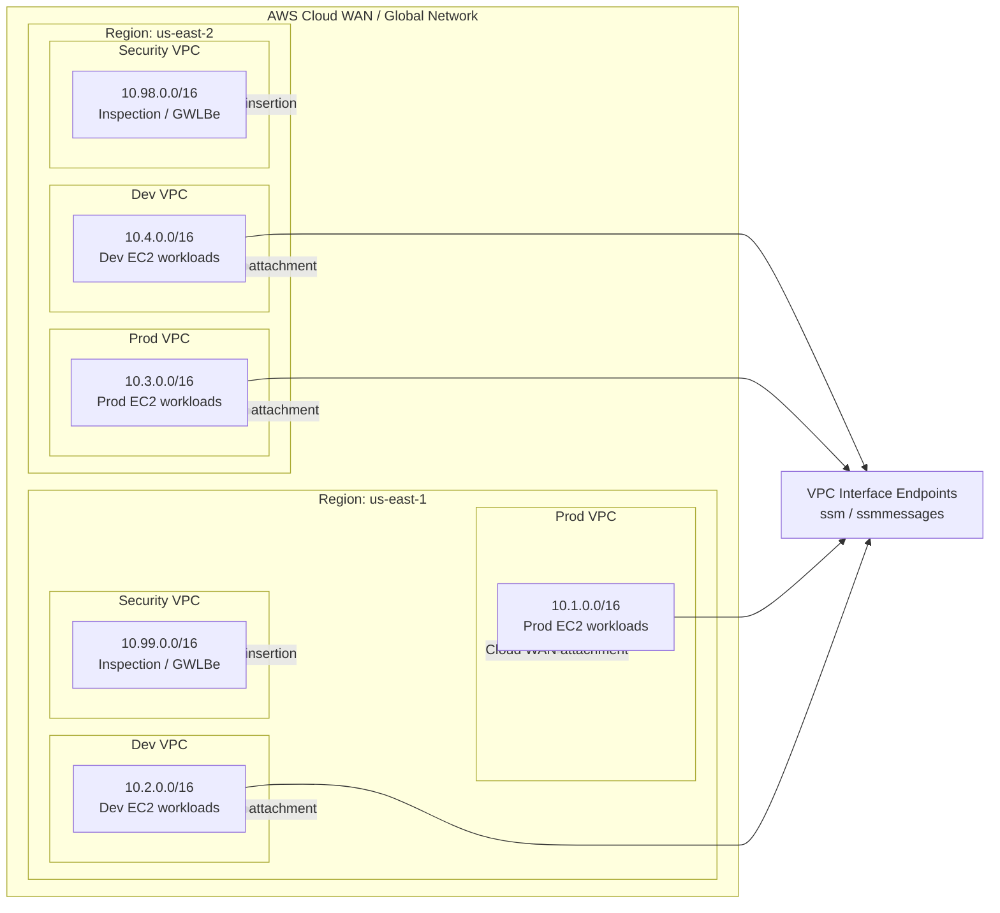
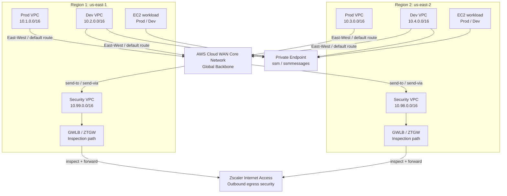

# AWS Cloud WAN ZTGW Terraform

This repository contains a Terraform deployment that follows the AWS Cloud WAN multi-region architecture described in the Cloud WAN deployment guide with configurable regions (defaulting to `us-east-1` and `us-east-2` for the two-region design).

The project is intentionally parameterized so the key deployment values are driven by variables:

- AWS region
- naming prefix (for example `dglading-cloud-wan-`)
- VPC endpoint service name (for example `com.amazonaws`)
- optional multi-region deployment switch (`multiregion_deployment`)

Set `aws_region` to the primary AWS region. For two regions, also set
`multiregion_deployment = true` and `secondary_aws_region` to a different region.
The default pair remains `us-east-1` and `us-east-2`. Each region must be enabled
for your account and provide at least two standard Availability Zones and the
required EC2 and SSM services. Available zones are discovered during planning.

CIDRs are assigned automatically without overlap: the guide's east-region pools
are preserved, and other regions receive separate pools by deployment position.
Naming suffixes default to the region name, except `1` and `2` for the guide's
regions. Override them with `region_suffix` and `secondary_region_suffix`.

For example, to deploy outside the guide's regions:

```hcl
aws_region             = "us-west-2"
multiregion_deployment = true
secondary_aws_region   = "eu-west-1"
```

Existing deployments: review the plan before applying. Changing regions changes
resource keys and replaces regional infrastructure; it does not migrate it.
The primary region now uses the first provider slot, including single-region
`us-east-2` deployments that previously used the second slot. Workloads now use
Amazon Linux 2023, which replaces existing Amazon Linux 2 instances. The optional
legacy `ec2messages` endpoint is no longer enabled by default; add it to
`ssm_endpoint_services` only where AWS supports it. AZ discovery can also change
subnet placement if the old assumed zones are not the first two available zones.

## What this Terraform creates

For the selected region, it provisions:

- 3 VPCs:
  - Production
  - Development
  - Security
- Subnets per the guide’s layout:
  - Cloud WAN attachment subnets
  - workload subnets
  - inspection subnets for the security VPC
- Workload security groups
- EC2 workload instances in the Prod and Dev workload subnets
- VPC interface endpoints for:
  - `ssm`
  - `ssmmessages`
  - optional legacy `ec2messages` (set `ssm_endpoint_services` where supported)

It also provisions the guide's Cloud WAN components (PDF steps 2–6):

- Global Network and Core Network, with edges in the configured deployment regions
- The core network policy JSON: isolated `Prod` and `NonProd` segments and `SecurityNFG`
- `send-via` service insertion for east–west traffic and `send-to` for egress
- Tag-based VPC attachment association (`Prod`, `NonProd`, and `Security`)
- VPC attachments using the dedicated attachment subnets; appliance mode enabled only for Security VPCs
- Dedicated spoke workload route tables with default routes to the core network
- Per-AZ Security attachment route tables and a private inspection return route to Cloud WAN
- One GWLB endpoint per Security inspection subnet, and its same-AZ attachment default route, when a regional Zscaler service name is supplied
- Optional per-workload-VPC Route 53 outbound DNS forwarding for ZPA applications
- The EC2 instance role/profile with `AmazonSSMManagedInstanceCore`; names use a generated suffix so deployments do not collide with existing IAM roles/profiles.

Spoke attachment subnets remain on the VPC's local-only main route table. The
Security VPCs use separate attachment and inspection route tables to keep the
forward and return inspection paths distinct.

## Architecture intent

This Terraform models the AWS Cloud WAN foundation for a design where the ZTGW is used to:

- protect east-west inter-VPC and inter-region traffic flows between application workloads
- steer internet-bound traffic from the Cloud WAN-connected VPCs into the security inspection path
- forward inspected traffic to Zscaler Internet Access (ZIA) for URL, threat, and policy enforcement
- keep management connectivity private by using AWS VPC interface endpoints instead of public ingress

The Security VPC acts as the inspection and forwarding layer for the Cloud WAN traffic flows, while the Prod and Dev VPCs host the application and management workloads that rely on the inspection path for both egress and service-to-service traffic control.

## ZTGW traffic handling

The AWS Cloud WAN and security VPC design in this repository is intended to place ZTGW in the control path for network traffic inspection.

- East-west traffic: application workloads in the Prod and Dev VPCs are steered through Cloud WAN toward the Security VPC so the ZTGW can inspect and enforce policy before allowing traffic to continue.
- Internet egress: default routes from the workload VPCs send outbound traffic to the Security VPC, where the ZTGW forwards the flow to Zscaler Internet Access for filtering and policy enforcement.
- Private management: AWS Systems Manager access is provided through private VPC interface endpoints rather than public internet connectivity.

This pattern enables both security and segmentation by ensuring the ZTGW is the enforcement point for cross-VPC and outbound web access, while the Cloud WAN backbone provides the transport path across regions.

## Cloud WAN policy and ZTGW integration

The local reference is `AWS Cloud WAN Multi-Region Deployment Guide - Google Docs.pdf`.
`policies/core-network-policy.json` contains its policy exactly as shown on pages
10–13, including ASN range `64512-65534`. Terraform replaces only the policy's
edge locations with `aws_region` and, when enabled, `secondary_aws_region`.

The core network is first bootstrapped with the `Prod` segment, then Terraform
publishes and executes the complete policy. Attachments wait for that policy to
be LIVE. The Security attachments join `SecurityNFG` via the `segment = Security`
tag and enable appliance mode for symmetric inspection. Core network and policy
operations have 60-minute timeouts for initial regional provisioning.

For the complete inspection path, obtain a GWLB endpoint service name from your
Zscaler deployment for every deployed region and set it in `terraform.tfvars`:

```hcl
ztgw_endpoint_service_names = {
  "us-east-1" = "com.amazonaws.vpce.us-east-1.vpce-svc-REPLACE_WITH_REAL_SERVICE_ID"
  "us-east-2" = "com.amazonaws.vpce.us-east-2.vpce-svc-REPLACE_WITH_REAL_SERVICE_ID"
}
```

Use your actual deployment region keys and service IDs. Zscaler must authorize
your AWS account for each service, the service must support both selected AZs,
and any required endpoint acceptance must be completed by the service owner.
Terraform creates one endpoint per inspection subnet and routes each Security
attachment subnet to its same-AZ endpoint. Inspection return routes send
`10.0.0.0/8` to the core network, as in PDF step 6.

You can leave `ztgw_endpoint_service_names = {}` to deploy Cloud WAN first.
The core network, NFG, all VPC attachments, and route tables are still created,
but GWLB endpoints and Security attachment default routes are deferred. The
`inspection_pending_regions` output lists what is missing. **Spoke transit and
Internet egress do not work until the inspection path and Zscaler policies are
configured and healthy.** No direct inspection bypass or AWS NAT path is added.
Adding service names and applying again completes the endpoint routes.

To inspect the resulting configuration after apply:

```bash
terraform output cloud_wan
terraform output cloud_wan_attachments
terraform output ztgw_gwlb_endpoints
terraform output inspection_pending_regions
terraform output -raw core_network_policy_json > core-network-policy.effective.json
```

The deployment identity also needs Network Manager permissions to create/delete
global and core networks, publish/execute core network policies, manage VPC
attachments, and read/tag these resources; EC2 permissions to manage route tables,
subnet associations, routes, and GWLB endpoints; and IAM permissions to manage the
SSM role/profile, attach its managed policy, and pass the role to EC2. Cloud WAN
may need permission to create its service-linked role on first use. Core network
edge/service availability must be verified for the selected AWS regions.

## Optional ZPA DNS forwarding

Set `zpa_dns` in your local `terraform.tfvars` to add the Route 53 Resolver
resources modeled on [Zscaler's ZPA Route 53 CloudFormation template](https://github.com/zscaler/cloud-native-aws-cloud-connector-deploy/blob/main/cloudformation-templates/zs_cc_cf_template_zpa_r53.yaml).
The default `zpa_dns = {}` disables this option. To enable it, replace that empty
assignment with a populated map like the example below. **Keep only one active
`zpa_dns` assignment in the file.** Edit `terraform.tfvars`; Terraform does not
automatically load `terraform.tfvars.example`.

The Terraform implementation does not require the CloudFormation macro or Lambda.

```hcl
zpa_dns = {
  "us-west-1-prod" = {
    application_domain_names  = ["apps.example.internal", "private.example.com"]
    target_ips                = ["185.46.212.88", "185.46.212.89"]
    target_port               = 53
    zscaler_cloud_name        = "zscaler.net"
    zpa_cloud_name            = "ZPA"
    additional_system_domains = []
  }
}
```

Each map key selects an existing managed workload VPC, `<region>-prod` or
`<region>-dev`, in an active deployment region. Add another entry to enable a
second VPC or region. Names are normalized to lowercase without a trailing dot;
use DNS suffixes such as `example.internal`, rather than `*.example.internal`.
Each suffix covers that domain and its subdomains. For example,
`web.example.internal` covers that hostname and names below it; use
`example.internal` to include every hostname under that domain.

### Which workloads use these rules?

The resolver endpoint has an ENI in each of the selected VPC's two workload
subnets. The forwarding rules are associated with the **entire selected VPC**,
so workloads in any of its subnets can use them when they query the VPC's
Amazon-provided DNS resolver. Workloads using a separate DNS server need that
server configured to use the appropriate forwarding path.

An entry for `us-west-1-prod` does not enable forwarding in `us-west-1-dev` or
another region. To enable both Prod and Dev, use one map with both keys:

```hcl
zpa_dns = {
  "us-west-1-prod" = {
    application_domain_names = ["example.internal"]
    target_ips               = ["185.46.212.88", "185.46.212.89"]
    zscaler_cloud_name       = "zscaler.net"
    zpa_cloud_name           = "ZPA"
  }
  "us-west-1-dev" = {
    application_domain_names = ["example.internal"]
    target_ips               = ["185.46.212.88", "185.46.212.89"]
    zscaler_cloud_name       = "zscaler.net"
    zpa_cloud_name           = "ZPA"
  }
}
```

Use keys for your actual deployment regions. Each VPC can have its own domain
list and DNS targets. Omitted optional fields use the defaults below.

### Variable settings

| Setting | Purpose / default |
| --- | --- |
| Map key | Required: an active managed `<region>-prod` or `<region>-dev` VPC |
| `application_domain_names` | Required: one or more application DNS suffixes |
| `target_ips` | 1–6 IPv4 DNS servers; defaults to `185.46.212.88` and `185.46.212.89` |
| `target_port` | DNS destination port; defaults to `53` |
| `zscaler_cloud_name` | Your Zscaler cloud domain; defaults to `zscaler.net` |
| `zpa_cloud_name` | `ZPA` (default) or `ZPA-Beta` |
| `additional_system_domains` | Extra domains to resolve through AWS instead of forwarding; defaults to `[]` |

The CloudFormation inputs map to this configuration as follows:

| CloudFormation parameter | Terraform configuration |
| --- | --- |
| `VPCID` | Selected by the `zpa_dns` map key; the managed VPC ID is derived |
| `ResolverEPSubnets` | Both existing workload subnets in that VPC, one in each AZ |
| `TargetIPs` | `target_ips`: 1–6 IPv4 DNS server addresses |
| `ApplicationDomainNames` | `application_domain_names`: application DNS suffixes |
| `ZscalerCloudName` | `zscaler_cloud_name`: your cloud's DNS domain |
| `ZPACloudName` | `zpa_cloud_name`: `ZPA` or `ZPA-Beta` |

Each configured VPC gets an outbound IPv4 endpoint with two ENIs, a forwarding
rule per application suffix, and rule associations for that VPC. Resolver endpoints
incur AWS charges. Security groups permit outbound TCP/UDP only to the configured
DNS targets and port, consistent with [AWS's outbound Resolver requirements](https://docs.aws.amazon.com/Route53/latest/DeveloperGuide/resolver-overview-forward-vpc-to-network.html).

As in the template, `SYSTEM` rules retain AWS resolution for `zscaler.com`,
`freebsd.org`, `ntp.org`, `amazonaws.com`, your selected Zscaler cloud domain,
and `prod.zpath.net` (`ZPA`) or `zpabeta.net` (`ZPA-Beta`). Use
`additional_system_domains` for further exceptions. Set `zscaler_cloud_name = ""`
to omit that one exception. An application suffix cannot exactly equal a SYSTEM
exception in the same VPC.

To forward all queries except the SYSTEM exceptions, use
`application_domain_names = ["."]` and supply your own DNS servers as targets,
as advised by the reference template. Ordinary application-only forwarding uses
the template's default Zscaler targets unless you override `target_ips`.

**Prerequisite:** DNS target traffic must traverse healthy ZTGW/Cloud Connector
services. The endpoint ENIs use the selected workload subnets' existing default
routes through Cloud WAN and `SecurityNFG`; the regional GWLB endpoints, Zscaler
DNS handling/forwarding policies, and ZPA application access must be configured.
Creating these DNS resources alone does not configure ZPA applications, establish
ZPA connectivity, or bypass a missing inspection path. Security/attachment subnets
are not used for outbound Resolver ENIs.

The deployment role needs `route53resolver` permissions to create, read, update,
delete, tag, and associate resolver endpoints and rules, plus the EC2 permissions
needed for their ENIs and security groups. Keep actual private application domains
in ignored `terraform.tfvars`, and review existing rule associations for the same
domains before applying.

### Apply and verify

After saving your `terraform.tfvars`, create and review a fresh plan:

```bash
terraform validate
terraform plan -out=tfplan
terraform apply tfplan
terraform output zpa_dns_resolvers
```

From a workload in a configured VPC, test an actual application hostname, for
example `nslookup web.example.internal`. A live DNS and ZPA connectivity check
requires the configured AWS/Zscaler environment.

To disable this option, set `zpa_dns = {}` and review/apply a new plan. Terraform
will remove the resolver endpoints, rules, associations, and their security
groups. Removing one map entry disables it only for that VPC.

## Validation

```bash
terraform fmt -check
terraform validate
# Terraform 1.7+; all providers are mocked and no AWS resources are created:
terraform test
```

The tests cover policy parity with the PDF, tagged attachments, appliance mode,
separate route tables, per-AZ endpoints, custom region pairs, and missing or
invalid endpoint configuration. AWS API acceptance and actual packet flow still
require a deployment and the guide's connectivity checks.

## EC2 workload behavior

The EC2 instances are created in the workload subnets for each Prod and Dev VPC, using the same naming prefix convention and region-based suffixing as the surrounding deployment.

The instance names follow the pattern:

```hcl
${var.naming_prefix}${vpc.short_name}-${az}-ec2
```

Examples:

```hcl
"dglading-cloud-wan-prod1-aza-ec2"
"dglading-cloud-wan-dev2-azb-ec2"
```

The deployment provisions Amazon Linux 2023 instances in the workload subnets. EC2 user data installs and starts `httpd`; package installation requires access to the package repositories through your configured egress path.

### User-data bootstrap for HTTP

The EC2 instances install and start Apache HTTPD using EC2 user data:

```hcl
user_data = <<-EOF
#!/bin/bash
yum update -y
yum install -y httpd
systemctl enable httpd
systemctl start httpd
EOF
```

This bootstrap is already enabled in the EC2 resource blocks. Instances need a
working ZTGW/ZIA egress path to download packages; if launched before that path
is ready, rerun the package installation after inspection is operational.

## Files

- `versions.tf` — Terraform and provider version requirements
- `provider.tf` — regional providers and the global Network Manager provider
- `cloud_wan.tf` — global/core networks, effective policy, and tagged VPC attachments
- `policies/core-network-policy.json` — JSON policy extracted from PDF pages 10–13
- `routing.tf` — route tables, associations, per-AZ GWLB endpoints, and routes
- `iam.tf` — workload SSM role and instance profile
- `zpa_dns.tf` — optional Route 53 outbound endpoints, ZPA forwarding rules, and SYSTEM exceptions
- `tests/zpa_dns.tftest.hcl` — mocked DNS integration and input-validation tests
- `tests/cloud_wan.tftest.hcl` — mocked integration tests (Terraform 1.7+ required)
- `variables.tf` — input variables
- `locals.tf` — derived values and subnet/VPC naming logic
- `main.tf` — AWS resources
- `outputs.tf` — resource outputs
- `terraform.tfvars.example` — example variable values
- `.gitignore` — standard Terraform exclusions

## Variables

The main variables are:

```hcl
aws_region = "us-east-1"
multiregion_deployment = false
naming_prefix = "dglading-cloud-wan-"
vpc_endpoint_service_name = "com.amazonaws"
region_suffix = "1"

# Optional Route 53 Resolver forwarding for ZPA; empty disables it.
zpa_dns = {}
```

See [Optional ZPA DNS forwarding](#optional-zpa-dns-forwarding) for the populated
map examples, VPC scope, target IPs, cloud settings, and deployment steps.

## Quickstart

### 1) Create your variable file

```bash
cp terraform.tfvars.example terraform.tfvars
```

Example contents for single-region `us-east-1`:

```hcl
multiregion_deployment = false
aws_region = "us-east-1"
naming_prefix = "dglading-cloud-wan-"
vpc_endpoint_service_name = "com.amazonaws"
region_suffix = "1"
```

Example contents for two-region deployment:

```hcl
multiregion_deployment = true
aws_region = "us-east-1"
secondary_aws_region = "us-east-2"
naming_prefix = "dglading-cloud-wan-"
vpc_endpoint_service_name = "com.amazonaws"
region_suffix = "1"
```

### 2) Initialize Terraform

```bash
terraform init
```

### 3) Validate the configuration

```bash
terraform validate
```

### 4) Review the deployment plan

```bash
terraform plan
```

### 5) Apply the deployment

```bash
terraform apply
```

### 6) Destroy the deployment when finished

```bash
terraform destroy
```

## Prerequisites

Before deploying this configuration, make sure you have:

- AWS CLI installed and configured with valid credentials
- An AWS account with permissions to create VPCs, subnets, security groups, EC2 instances, and VPC interface endpoints
- Access to the target AWS regions configured for the deployment
- Terraform 1.5 or newer installed locally

Example AWS authentication:

```bash
aws configure
# or
export AWS_PROFILE=my-profile
export AWS_REGION=us-east-1
```

Required IAM permissions typically include actions such as:

- `ec2:CreateVpc`
- `ec2:CreateSubnet`
- `ec2:CreateSecurityGroup`
- `ec2:AuthorizeSecurityGroupIngress`
- `ec2:AuthorizeSecurityGroupEgress`
- `ec2:RunInstances`
- `ec2:CreateVpcEndpoint`
- `ec2:Describe*`
- `ec2:ModifyVpcAttribute`

If you are using AWS Organizations or a restricted role, confirm that your deployment identity has the required EC2, VPC, and Systems Manager permissions.

## Notes

- The configuration is designed to match the naming conventions and CIDR layout in the deployment guide.
- Terraform creates the Global Network, Core Network, LIVE core network policy, VPC attachments, and local route tables. Network Manager uses its global API endpoint in `us-west-2`; regional edges follow the configured region variables.
- The policy JSON follows the guide. `SecurityNFG` is defined inside that policy, rather than as a separate Terraform resource. Only the edge locations are adjusted dynamically.
- Cloud WAN inspection and egress require healthy ZTGW/ZIA services. When `inspection_pending_regions` is non-empty, endpoint service names are still missing and transit is not operational in those regions.
- ZTGW deployment, service authorization/acceptance, ZIA configuration, and the guide's Zscaler forwarding policies remain external prerequisites.
- The EC2 workload layer is intentionally simple and can be extended with application-specific user data or autoscaling policies when needed.
- The design assumes a ZTGW inspection path for both internet egress and east-west traffic enforcement, forwarding traffic to Zscaler Internet Access for policy inspection and secure routing.

## Deployment diagram



This represents the deployment pattern described in the guide: a multi-region Cloud WAN backbone with production and development spoke VPCs in each region, a centralized security VPC for inspection, EC2 workloads in the application VPCs, and private SSM interface endpoints used for management without public ingress.

## Detailed inspection and egress flow



This diagram reflects the guide’s traffic patterns:

- East-west traffic between the Prod and Dev segments is regulated by local forwarding rules and default drop rules per region.
- Outbound traffic to the public internet is sent to the Security VPC and then inspected by the ZTGW and ZIA policy enforcement stack.
- Management traffic to AWS Systems Manager uses private VPC interface endpoints instead of public ingress.
- EC2 instances run inside the workload subnets and can be extended with application-level user data when required.

## Example variable file

See `terraform.tfvars.example` for a ready-to-edit example.
